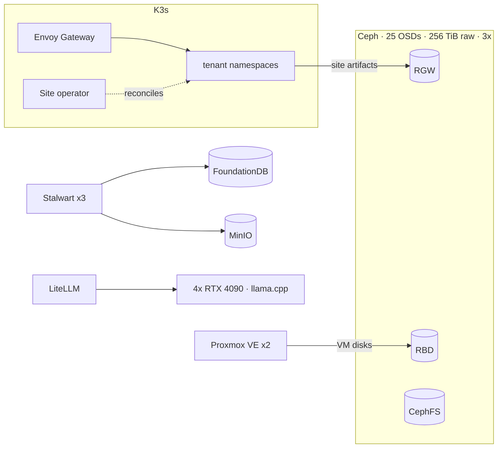

# Cesar Petrescu

Infrastructure & SRE engineer · Sysadmin @ RADIOCOM · Founder, PhotonSpark (AS216249) · Bucharest

[cesarpetrescu.com](https://cesarpetrescu.com) · [CV](https://cesarpetrescu.com/cv) · [LinkedIn](https://www.linkedin.com/in/cesar-petrescu-98a683267/) · [cesar@photonspark.com](mailto:cesar@photonspark.com)

Open to SRE / DevOps / infrastructure roles: remote, or onsite in Bucharest.

## What I run (PhotonSpark)

- **Ceph:** designed and operate a shared cluster (25 OSDs, 256 TiB raw, 3x replication, RBD for VM disks and CephFS) backing two Proxmox VE clusters and a 15+ server fleet (Dell R720, HPE DL360 Gen8/Gen10, i9-13900KS GPU nodes).
- **K3s hosting platform** (cPanel alternative): Go API and a controller-runtime operator that reconciles a `Site` CRD into per-tenant namespaces; Envoy Gateway edge on public-IP nodes; cert-manager with Cloudflare DNS-01; site artifacts on Ceph RGW, served by a generic runtime image.
- **Mail:** 3-node Stalwart cluster on own IP space (FoundationDB for data, MinIO for message storage), thousands of emails a month, zero-downtime upgrades.
- **AS216249**, with the company's network engineer: own /24 announced over eBGP to upstream transit, standby DDoS-mitigation sessions.
- **Inference:** 4x RTX 4090 cluster behind LiteLLM, served with llama.cpp via [AutoLLama](https://github.com/CesarPetrescu/llama-cpp-autodeploy); MTP speculative decoding reaches 171 tok/s on Qwen3.6-35B-A3B.



## Experience

| Role | Org | Dates |
|---|---|---|
| System Administrator | RADIOCOM | Sep 2023 – present |
| CTO & Founder | PhotonSpark | Jan 2022 – present |
| Infrastructure & Network Consultant | Freelance | 2026 – present |
| Network Administrator | Five Cyber Host Security | Oct 2022 – Jan 2023 |

- **RADIOCOM:** Deployed a nationwide high-availability VPLS network for a major client, linking all sites at Layer 2. HA network on Cisco hardware, office network upgraded to FortiGate, Linux and Windows servers with automated backups. Developed RADI and built the ticketing and log-tracking tool used by the NOC and SOC teams.
- **PhotonSpark:** Everything under *What I run*, plus a Go control plane for ops automation: a stateless, event-sourced orchestrator where the LLM proposes actions and a policy layer approves or denies them, with an append-only audit log. Self-hosted Keycloak SSO, Nextcloud, mail and Matrix. Won at [Innovation Labs](https://www.innovationlabs.ro/teams/PhotonSpark); featured in [ZF.ro](https://www.zf.ro/business-hi-tech/zf-it-generation-photon-spark-echipa-studenti-politehnica-matematica-22435014) and [Euronews](https://www.youtube.com/watch?v=bJEOjXv55nw).
- **Consultant:** For a medical clinic, run the UniFi network and built a WireGuard site-to-site tunnel to a software vendor instead of GRE. In progress: a Zimbra 8.8.15 to Stalwart migration, 18 domains, feature-parity tested, domain by domain.
- **Five Cyber Host Security:** Routers and VPNs across data centers; firewall rules and intrusion analysis.

CS student at UPB (National University of Science and Technology POLITEHNICA Bucharest), Oct 2023 – present. CCNA. CCNA instructor at Hackademy, UPB, since Oct 2023; built [hackademy.ro](https://hackademy.ro) and awg.sprk.ro.

## Selected work

| Project | What it is | Stack | Link |
|---|---|---|---|
| **Ledger** | Self-hosted MCP project-context registry and append-only decision log, used by Claude, Codex CLI, ChatGPT and self-hosted agents; drives a daily multi-agent news pipeline | Go, PostgreSQL, OAuth (CIMD), Qwen3 embeddings + reranker, Docker Compose | [repo](https://github.com/CesarPetrescu/ledger) |
| **Hosting platform** | Multi-tenant K3s platform: Go API and controller-runtime operator reconciling a `Site` CRD into per-tenant namespaces | K3s, Go, Envoy Gateway, cert-manager, Ceph RGW | [live](https://webhost.photonspark.com) |
| **Stalwart mail cluster** | 3-node mail cluster on own IP space, zero-downtime upgrades | Stalwart, FoundationDB, MinIO | private |
| **Adastrion Core** | Speech service (STT, TTS, VAD, speech-to-speech) and sandboxed coding agent; per-chat sandboxes (VNC, Chrome CDP, MCP) run by a planner, executor and checker pipeline; JWT gateway auth | React, Flutter (Android, Wear OS), SSE, WebSocket | private |
| **AutoLLama** | llama.cpp build and deploy toolkit: CUDA/MMQ and MKL/OpenBLAS builds, TUIs with live memory planning, RPC distributed inference with worker auto-discovery, fail-fast misconfiguration guardrails | Python, llama.cpp, LiteLLM | [repo](https://github.com/CesarPetrescu/llama-cpp-autodeploy) · [write-up](https://photonspark.com/blog/how-we-deploy-llama-cpp) |
| **RADI** | RADIOCOM's internal RAG assistant over procedures, work instructions and regulations: routes each question, multi-hop retrieval with reranking, checks its answer against the sources and says "I don't know" instead of guessing | RAG, reranking | private |
| **Tire sidewall recognition** | Embossed black-on-black sidewall text to structured JSON: polar unwrap into sector crops, multi-view PaddleOCR, self-hosted VLM pass, deterministic validation with per-field provenance and human review | PaddleOCR, llama.cpp | private (client) |
| **Electrical Age port** | Java/Kotlin circuit-simulation Minecraft mod, ported from Forge 1.7.10 to 1.12.2, then to NeoForge 1.21.1 | Java, Kotlin, NeoForge | [repo](https://github.com/CesarPetrescu/ElectricalAge) |

<details>
<summary><b>More projects</b></summary>

- **[PocketExit](https://github.com/CesarPetrescu/PocketExit):** SOCKS5 proxy whose exit nodes are Android phones; one authenticated WebSocket per circuit, control and exit routes chosen independently (control over Wi-Fi, exit over the SIM), phones only dial out. Go, Kotlin.
- **[PocketHost](https://github.com/CesarPetrescu/PocketHost):** Android foreground service supervising native Go daemons (static web, file API, reverse proxy, Cloudflare DDNS/Tunnel), loopback-first by default. Go, Kotlin.
- **[CrabSQL](https://github.com/CesarPetrescu/CrabSQL):** MySQL wire-protocol server: `mysql_native_password` auth, prepared statements, joins, aggregates, transactions with savepoints, `information_schema` subset. Rust.
- **[lsp-mcp](https://github.com/CesarPetrescu/lsp-mcp):** exposes LSP navigation (definition, references, hover, call hierarchy, code actions) as MCP tools for Codex CLI. Python.
- **[Even Notes](https://github.com/CesarPetrescu/evenNotes):** notes pushed live to Even G2 glasses over WebSocket. Node.js, TypeScript.
- **[SparkAI Canvas](https://vibeapps.dev/s/sparkai-canvas):** voice-first spatial workspace; 1st at Cursor Hackathon Bucharest 2025.
- **Dual-ESP32 audio-reactive LEDs:** two ESP32s over ESP-NOW drive 800 WS2812B LEDs from a subwoofer signal.

</details>

## Writing

Technical write-ups on [photonspark.com](https://photonspark.com/blog):

- [How we deploy llama.cpp at PhotonSpark](https://photonspark.com/blog/how-we-deploy-llama-cpp)
- [Serving Qwen on two RTX 4090s: vLLM for traffic, llama.cpp for context](https://photonspark.com/blog/vllm-llama-cpp-qwen-dual-4090)
- [TurboQuant and the KV cache problem](https://photonspark.com/blog/turboquant-kv-cache-benchmarks)
- [Anycast DNS without the magic](https://photonspark.com/blog/anycast-dns-without-the-magic)
- [Kubernetes vs Docker Swarm: pick the platform you can operate](https://photonspark.com/blog/kubernetes-vs-docker-swarm)
- [When Docker Compose is the right answer](https://photonspark.com/blog/when-docker-compose-is-the-right-answer)

## Competitions and security

```
🥇 SparkAI Canvas        - Cursor Hackathon Bucharest 2025
🥇 AI onboarding app     - Innovation Labs CyberHack 2024
🥈 AI homework checker   - EESTEC Olympics 2024
🥈 Robot maze solver     - HARD & SOFT 2025
🏅 Applied CS (5th)      - AcadNet Olympiad 2023 (National)
🐛 Permissions bypass    - Google VRP, Jun 2025
```

Google VRP: a permissions bypass let unauthenticated callers fetch transcripts of Members-only and Premium YouTube videos through the Generative Language API (`file_data.file_uri`).

## Stack

- **Languages:** Go, Python, TypeScript/JavaScript, C, Java/Kotlin, Swift, Bash, SQL
- **Networking:** WireGuard, GRE, VLANs, firewalling (FortiGate, nftables, pfSense), Cisco IOS, UniFi
- **Infrastructure:** Kubernetes (K3s), Proxmox VE, Ceph, Docker, Ansible, Envoy, cert-manager
- **Observability:** Prometheus, node_exporter
- **Data:** PostgreSQL (CloudNativePG), MySQL/MariaDB, Redis, FoundationDB, ArangoDB, Neo4j
- **Vector:** Qdrant, pgvector
- **AI/LLM:** llama.cpp, vLLM, SGLang, LiteLLM, NVIDIA NeMo, RAG (hybrid retrieval, reranking)
- **Agents:** Claude Code, Codex CLI, Hermes Agent, MCP
- **OS:** Linux, Windows Server, OpenBSD, Android, iOS
